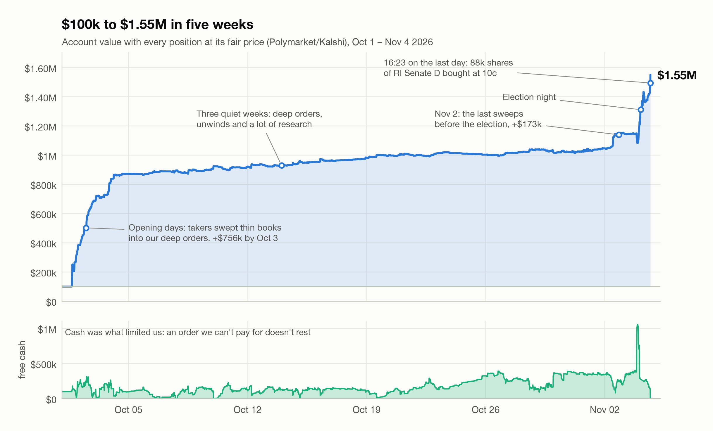
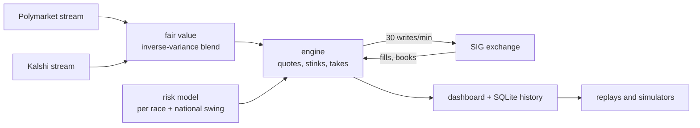
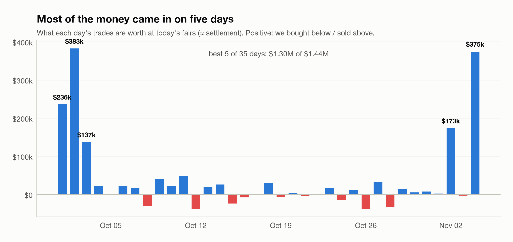
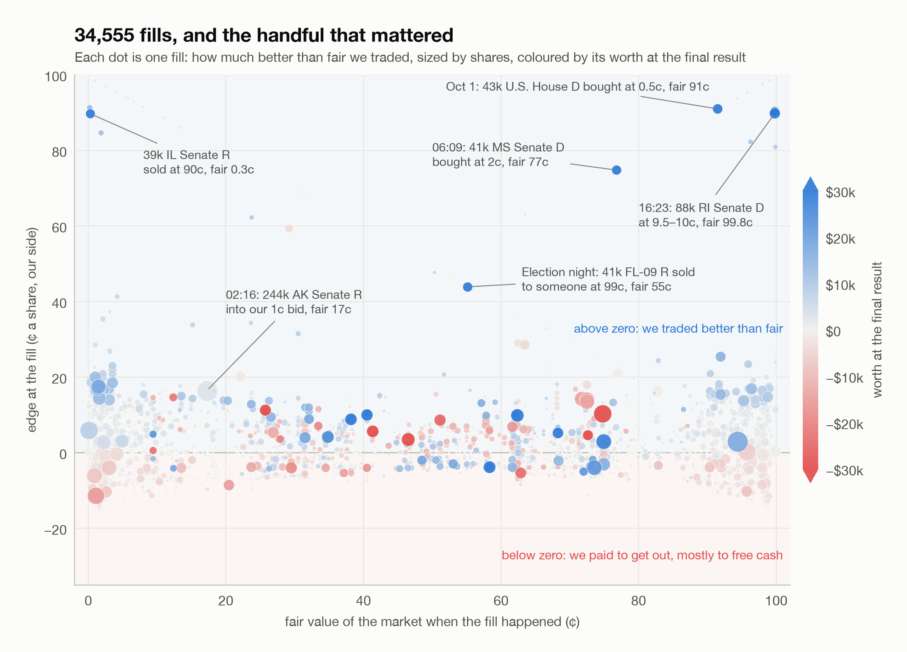
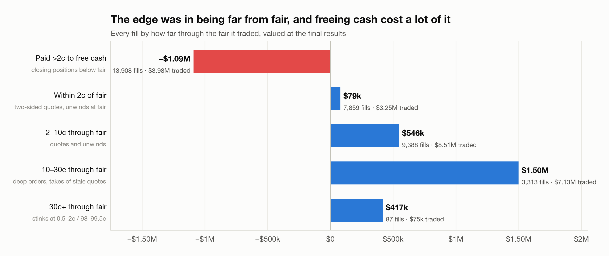
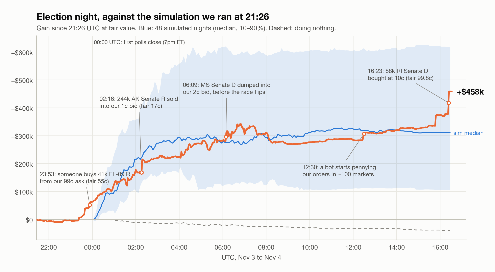
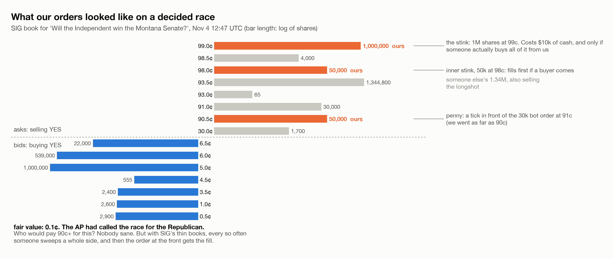
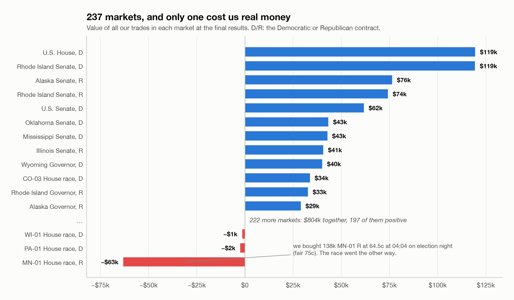
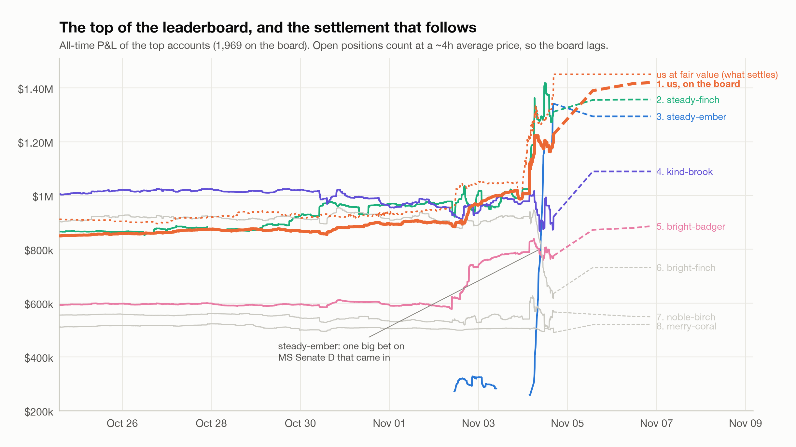

<!--
DRAFT, Nov 4 2026, written before settlement. Things to fill in or decide:
  - final rank and balance once SIG settles (search for TBD)
  - "How it was built" now says the code was written with Claude Code and that it ran the night shift; cut or reword if you'd rather not
  - the server hunt: add how many servers/regions you tried if you remember (search for TODO servers)
  - sunny-acorn: say whether you sent SIG the email (search for TODO email)
Figures: uv run python make_figures.py (data/ stays in the private repo, built by prep_data.py)
-->

# Market making the 2026 midterms on SIG's prediction market

<picture>
  <source media="(prefers-color-scheme: dark)" srcset="figures/equity_curve-dark.png">
  
</picture>

From October 1 to November 4 2026, Susquehanna (SIG) ran the SIG Predictions Cup: a prediction market on the US midterms where everyone started with 100,000 play dollars and was ranked on their balance after every market settled. There were 237 contracts ("Will the Republican Party win the Maine Senate?" and so on), a 0.5c tick, an API with 30 writes and 100 reads a minute, and by the end 1,969 accounts on the leaderboard.

I entered alone with an automated market maker that I started building the day before the open. It finished with **$1.55M at fair value**, about 15x the starting money, from 34,555 fills in 236 markets. On SIG's own leaderboard it ends the trading period at **#3**. The final ranking comes after settlement: **TBD**.

Almost nothing went the way I planned on day one. This is the story of what happened instead.

## Contents

- [The day before](#the-day-before)
- [The opening hour](#the-opening-hour)
- [The cash that wasn't locked](#the-cash-that-wasnt-locked)
- [Where the money came from](#where-the-money-came-from)
- [Running out of cash](#running-out-of-cash)
- [The quiet weeks](#the-quiet-weeks)
- [Getting ready for one night](#getting-ready-for-one-night)
- [Election night](#election-night)
- [The last morning](#the-last-morning)
- [The leaderboard is not the score](#the-leaderboard-is-not-the-score)
- [What I'd tell myself on September 30](#what-id-tell-myself-on-september-30)
- [How it was built](#how-it-was-built)

## The day before

The plan was textbook market making. Polymarket and Kalshi run deep markets on the same races, so their prices give a decent fair value. SIG's books would be thin and full of people clicking by hand. Quote both sides around that fair and collect the spread.

I wanted to be the fastest one there, so a good part of September 30 went into finding where SIG actually runs. Every API response carried a header like `x-vercel-id: fra1::sfo1`, which meant my requests from the Netherlands landed on a Frankfurt edge and were then forwarded to a function in San Francisco. SIG's database resolved to an AWS address in us-west-1. From home, every SIG call took 270-290 ms. I tried a bunch of AWS servers <!-- TODO servers: how many / which regions? --> and settled on a small one in us-west-1a, where the same request came back in 34 ms instead of 199 ms. It cost about $24 a month.

The other decision that day looked minor. Late in the afternoon I added one more thing to the engine: a 3,000-share bid at 0.5c and an ask at 99.5c in every market, in case someone fat-fingered an order. Traders call these stink bids. It was almost an afterthought. It turned out to be the most important line of config in the whole project.

## The opening hour

Trading opened on October 1 at 16:00 UTC, and SIG's servers immediately struggled. Batches came back with 503s and cancels took 1-2 seconds each. My engine sent its batches back to back, got stuck waiting to reconcile the account, and for the first half hour the only orders it managed to rest were the stinks. No quotes at all.

It didn't matter. The first fill came 19 seconds after the open: someone sold us 3,000 shares of "Democrats win the House" at 0.5c while Polymarket had it at 91c. Then more, all over the board. People sold at 0.5c and bought at 99.5c into near-empty books, because they asked for a size and not a price. After 32 minutes the account was worth $190k at fair value, all of it from orders I almost didn't place.

The best fill of the day came from a bug. Because the engine was stuck, it couldn't see that its House stink had filled, so it kept placing a new one. At 16:20 someone sold 43,350 shares into it at 0.5c. That one fill is worth $43k at the final fair. A minute later I placed a 200,000-share ask at 99.5c on the Senate by hand, because the bot was too busy being broken to do it.

## The cash that wasn't locked

Up to then I had sized everything assuming that a resting order locks cash, like a broker would. The engine split the balance across all its orders so that every one of them could be paid for if they all filled at once. That made every order small.

An hour in, the numbers didn't add up. The balance read 131,491 with about $57k of orders resting. The engine then cancelled $48k of those orders and the balance went to 132,057, which was exactly the fills in between. If SIG held cash for open orders, it should have jumped by $48k. SIG reserves nothing for resting orders. It only checks the balance when an order arrives.

So a 1M-share stink at 99c costs nothing until it fills, and when it fills it costs 1c a share for something worth a dollar. That evening the stinks went from 3,000 shares to 20,000, and a new layer of "deep" orders went in that could each reach 100k. Even so, the account in first place had about four times our P&L by the evening, mostly, I think, because their stinks were bigger than ours.

The catch came four days later, and it was expensive. SIG doesn't check an order against the whole balance. It checks it against the balance minus your other orders in that same market. For the first four days, 97-99% of my placements got an "ok" back from SIG without ever being placed. The dashboard showed hundreds of orders going out every minute and almost none resting. Once the engine filtered out orders SIG wouldn't admit before sending them, the same write budget went to orders that could actually fill. It's the most expensive bug I've had in any project, and on the dashboard everything looked busy and fine.

## Where the money came from

<picture>
  <source media="(prefers-color-scheme: dark)" srcset="figures/daily-dark.png">
  
</picture>

Over half of the total came in the first three days. On a fresh exchange with thin books, people sent big market orders that went straight through every level on one side. Of 443 sweeps of 5k+ shares that reached 5c past fair, 81% stopped part-way into a level. Whoever rested deep in the book got filled at prices that made no sense.

So the bot became mostly a machine for resting large orders far from fair and getting the cash back out of the positions they left behind. The fill map shows it. Most fills sit near zero edge, and the money is in the few dots far above the line:

<picture>
  <source media="(prefers-color-scheme: dark)" srcset="figures/fill_map-dark.png">
  
</picture>

Grouped by how far through the fair each fill traded:

<picture>
  <source media="(prefers-color-scheme: dark)" srcset="figures/edge_buckets-dark.png">
  
</picture>

The 86 fills more than 30c through fair used $75k of cash and are worth $413k. The 3,294 fills 10-30c through fair, mostly deep orders and takes of stale quotes, are worth $1.46M. Everything within 2c of fair, which is what I set out to do, added about $100k.

I didn't give up on tight quoting easily. On October 3 the big sweeps were fading, spreads had narrowed, and I was ready to pivot to tight market making around SIG's own mid. I ran simulation after simulation of it. Over one 48-hour replay of the live engine, the inner orders resting in front of sweeps made $93k and the near-fair ladder quotes made $200. Not $200k. Two hundred dollars.

## Running out of cash

Every fill of a deep order turns cash into a position that only pays out at settlement on November 4. On October 1, sweeps took free cash from $55k to $1k within half an hour. From then on, the bot was always choosing between keeping cash free for the next sweep and holding positions that were worth more than SIG would pay for them today.

On October 6 the balance was 17 dollars. I seriously considered starting over with something simpler, because there were so many layers that I couldn't tell anymore what was doing what. The numbers talked me out of it: $844k was sitting in five positions that pay out at settlement, the biggest a 500k-share short on "Republicans win the Rhode Island Senate". Selling them would have cost 12-18% of their value. The cash had turned into positions, and getting it back had a price.

That price shows up as the red bar in the edge chart, about $1.0M of value given up over five weeks to free cash. It funded the fills in the blue bars, so it was worth it, but it was the biggest single cost and the hardest thing to tune. A change that looked good in simulation (closing positions from 1,000 shares instead of 2,000) lost $7.6k in a replay of the real code, and I rolled it back.

The simulators ended up mattering more than any single strategy idea. My first one walked sweeps through stored book snapshots and overstated how deep they reach, which pushed me to a 40% return floor that was far too strict. The replacement, `stinksim`, treats a sweep as a size that gets conserved, and I calibrated it against real fills until it landed within 1.1-1.2x of them. It was slow, and the first attempt to speed it up only gained 1.3x. The numba version, `fastsim`, ran 25x faster with the same fills, which meant I could test changes over many windows instead of one. A change only went live after it won in several windows, in the replay of the real code, and under a stress setting.

## The quiet weeks

From mid October the books settled down and the bot mostly ran by itself, with no commits at all for over two weeks. By October 24 we were #4 of 1,771 on the all-time board, $155k behind the leader, and #1 on the weekly board.

On October 29 I noticed something odd in market 949. Someone had bought hard, our ask sold them 11,168 shares at 49c, and three seconds later our own take layer bought exactly those shares back at 49.5c. The cause was a setting from the October 1 cash panic that let the bot close any position at up to 4c worse than fair. In markets where one of our own asks rested in that range, the take tried to buy from it, SIG's self-match prevention filled nothing, and the engine retried every 2-3 seconds: 13,239 takes in six hours, nearly the whole write budget, for weeks. A four-week-old emergency setting had been quietly eating most of the rate limit.

## Getting ready for one night

Results night was the obvious opportunity. When a race is called, its loser goes to zero on Polymarket and Kalshi within seconds, but SIG's books are full of orders people placed days ago and aren't watching. A scan of all 237 books on October 29 found about $40M of expected profit sitting at levels a call would pay at least 20c a share on, and 68% of that size hadn't moved in five and a half days. Nobody had the cash to take more than a sliver of it. Cash would be the limit again.

So we started hoarding. The bot sold positions where turning them into cash cost at most 10% and went from $165k to $324k of cash in one round. The expensive ones (the Rhode Island Senate and Governor, Wyoming, South Carolina) I kept as a reserve to sell on the night only if the takes ran dry. Holding them cost nothing if the stale quotes never showed up.

Two days before, I built a separate simulator, `stalesim`. It starts from a live snapshot of every book and our positions and plays out the night with every quote stale, fairs jumping on calls, and other bots competing for the same stale levels. Its first result was a warning: our own ~7,000 resting orders were the biggest stale quotes on SIG. Leave them up through the calls and other bots pick them off for about $730k. The night plan started with one global cancel-all at 21:00 UTC.

Then the engine would only take a stale level when its return beat `r*`, the return a dollar of cash could still expect from the races not yet called, which the planner kept recomputing through the night. And one more idea of mine: if election night brings more panicked traders, the stinks should stay, and be much bigger. At 21:22 UTC they went to 1M shares at 1c and 99c in every market.

## Election night

<picture>
  <source media="(prefers-color-scheme: dark)" srcset="figures/night-dark.png">
  
</picture>

Soon after the first polls closed at 23:00 UTC, the stinks started filling. At 23:53 UTC someone bought 41k shares of FL-09 R from our 99c ask while the race was a coin flip, at a fair of 55c. It went to the Democrat: +$40k.

Around midnight other people caught on. Big orders started appearing one tick in front of our stinks, so we added 50k-share stinks at 2c and 98c in front of the 1M ones. Then came the worst idea of the night. Takers were buying near-certain losers at 10c and up, so the bot started selling those longshots at 6c through fair. In ten minutes 75 resting quotes filled 545k shares and spent about $500k of cash, at a 6.9% return, which was worse than keeping that cash for later calls. The floor that was supposed to stop them only blocked new quotes, and the old ones kept filling. We pulled them and later put them back at 40c through fair.

Just after 2 a.m. my time I went to bed. Claude Code kept watch: it checked the engine every ten minutes and had my permission to fix bugs, deploy and trade until I woke up. It deployed three fixes overnight, two of them for quotes that looped place-and-cancel when fairs jittered around a cutoff. Two of the best fills came while I slept:

- 02:16 UTC: 244k shares of Alaska Senate R sold into our 1c bid, fair 17c: +$55k.
- 06:09 UTC: Mississippi Senate D dumped into our 2c bid, shortly before the race moved toward the Democrats. By the afternoon it traded at 92c.

The stinks were the night's best strategy by far: about +$186k on $17k of cash. Raising cash was the worst: −$75k at the latest fairs. The planner kept closing positions near fair in small chunks long after cash stopped being scarce, and some of what it sold was later worth a lot more.

## The last morning

The morning after was quiet, so I tried one more thing. Wherever someone else rested a big order (20k+) near a decided race's extreme, the bot placed 50k one tick in front of it, up to 10c. Within two hours a bot started doing the same to us, placing 30k orders one tick in front of our pennies in about 100 markets at once. Re-pricing ours meant a cancel and a new order for each, the cancels ran into SIG's rate limit, and for ten minutes nothing new got placed anywhere. The fix was to leave the jumped order where it was and add the new one in front. The old one was still a perfectly good order.

This is what a decided race's book looked like that morning, with our three layers on the ask side. Nobody sensible pays 90c for something worth 0.1c, but someone might click it:

<picture>
  <source media="(prefers-color-scheme: dark)" srcset="figures/book_ladder-dark.png">
  
</picture>

Two trades in the last hour:

- 16:13 UTC: Montana's Senate race had been called for the Republican, but someone was bidding 5-6c for 1.45M shares of the Independent. Cash is worth nothing after the close, so I lowered the edge threshold and the bot put the whole balance into it: 139k shares sold at 6c, about +$8k.
- 16:23 UTC: someone sold 88k shares of Rhode Island Senate D into our pennies at 9.5-10c, on Jack Reed's seat, fair 99.8c. That's +$79k, the single best fill of the competition, ten minutes after we'd spent our last cash. It filled anyway, because the orders were already resting.

Rhode Island's Senate race was worth $193k across its two markets in the end, more than any other race. It had been in the top holdings since the first week.

<picture>
  <source media="(prefers-color-scheme: dark)" srcset="figures/markets-dark.png">
  
</picture>

Across 236 markets only one lost real money: MN-01 R, where the bot bought 138k shares at 64.5c on election night (fair 75c) and the race went the other way. The edge was real. The size was too big for how uncertain that fair was.

## The leaderboard is not the score

<picture>
  <source media="(prefers-color-scheme: dark)" srcset="figures/leaderboard-dark.png">
  
</picture>

SIG's leaderboard values open positions at about a four-hour average of traded prices. On thin markets that lags reality by hours and swings with single small trades. Our board number sat $100-300k below our value at fair for most of the last day. steady-finch, top of the board that morning, lost $144k on the board in an afternoon without making a single trade, because its Senate-control positions were re-marked off a few small sells at 70-79c in a market worth 99.9c.

The board can also be gamed. On October 2 an account jumped from about +$8k to +$600k in one day, matched almost exactly by the losses of twelve brand-new accounts trading 30,000-share blocks back and forth with it. <!-- TODO email: did you send SIG the email about sunny-acorn? If so: "I sent SIG the trade tape and the account list." --> After that I stopped treating the board as a benchmark and reconstructed the leaders' positions from their P&L and the public tape instead, which told me a lot more.

## What I'd tell myself on September 30

**Place the stinks, and make them big.** The edge on a young, thin exchange is in being there when someone makes a mistake, with size, at a price far from fair. I spent most of my early effort on quoting tighter, and almost none of the profit came from it.

**Find out what the exchange actually does with your orders.** Two of my biggest early mistakes came from assuming how SIG handles cash. I sized orders small because I thought they locked cash, and then for four days 97% of them silently didn't exist. Both would have been caught in an hour of testing against the real API.

**Think in return on cash.** When cash is limited, every strategy competes for the same dollars, and the price of freeing cash matters as much as the edge of the trade it funds. I thought about the problem as P&L for weeks before switching. The second framing made almost every decision clearer.

**Emergency settings need an expiry date.** The October 1 cash rule was right for that day and wrong for the four weeks after it.

**A simulator is only as good as its fill model.** Calibrate it against real fills, and be suspicious of any result that depends on fills you've never seen happen.

**Restarts are part of the strategy.** Early versions cancelled every order on start, which threw away the queue position the stinks lived on. It took until election night before a restart kept every resting order exactly as it was.

## How it was built

Five weeks, one person, about 130 commits, ~18k lines of Python and 298 tests. Most of the code was written together with Claude Code, an AI coding agent: I decided what to build and what to trade, and it did most of the typing and the data digging, and on election night it ran the desk while I slept. That changed what one person could build in five weeks, from a single quoting script to a full engine with a dashboard, replays and three simulators. The ideas that made the most money, the stinks and saving cash for election night, still came from staring at order books.

The engine, the research and the trade data stay private. The figures in this write-up come from [`make_figures.py`](make_figures.py).

Thanks to SIG for running the Cup. It was a lot of fun.
