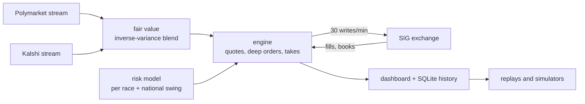

<!--
DRAFT, Nov 4 2026, written before settlement. Things to fill in or decide:
  - final rank and balance once SIG settles (search for TBD)
  - whether to say how much of the code was written with an AI coding agent (see "How it was built")
  - links: the relative links below assume this sits in the sigmm repo; change them if the write-up moves to its own repo
Figures: uv run python writeup/make_figures.py (data in writeup/data, built by prep_data.py)
-->

# Market making the 2026 midterms on SIG's prediction market

<picture>
  <source media="(prefers-color-scheme: dark)" srcset="figures/equity_curve-dark.png">
  
</picture>

From October 1 to November 4 2026, Susquehanna (SIG) ran the SIG Predictions Cup: a prediction market on the US midterms where every participant started with 100,000 play dollars and was ranked on their balance after every market settled. There were 237 contracts ("Will the Republican Party win the Maine Senate?" and so on), a 0.5c tick, an API with 30 writes and 100 reads a minute, and by the end 1,969 accounts on the leaderboard.

I entered alone with an automated market maker, which I started the day before the competition opened and kept rebuilding for five weeks. It finished with **$1.55M at fair value**, a gain of about 15x, from 34,555 fills in 236 markets. On SIG's own leaderboard it ends the trading period at **#3**. The final ranking comes after settlement: **TBD**.

## Contents

- [The setup](#the-setup)
- [What actually made money](#what-actually-made-money)
- [Cash was the real constraint](#cash-was-the-real-constraint)
- [Election night](#election-night)
- [The last day](#the-last-day)
- [The leaderboard is not the score](#the-leaderboard-is-not-the-score)
- [Things I got wrong](#things-i-got-wrong)
- [What I learned](#what-i-learned)
- [How it was built](#how-it-was-built)

## The setup

The idea at the start was ordinary market making. Polymarket and Kalshi run deep, liquid markets on the same races, so their prices make a decent fair value. SIG's books were thin and full of people trading by hand, so the plan was to quote around that fair and keep the risk per race in check.

It ran on a small AWS box in us-west-1, next to SIG's servers, as one asyncio process. Around it I built a dashboard for watching every market, a SQLite store with every book, fair, trade and fill (8 GB by the end), and a set of replays and simulators to test changes against recorded data before shipping them. The engine is about 18k lines of Python with 298 tests.

The first lesson came within hours. Tight two-sided quotes barely mattered, and the money was somewhere else.

## What actually made money

<picture>
  <source media="(prefers-color-scheme: dark)" srcset="figures/daily-dark.png">
  
</picture>

Over half of the total came in the first three days. On a fresh exchange with thin books, people sent big market orders that went straight through every level on one side. Of 443 sweeps of 5k+ shares that reached 5c past fair, 81% stopped part-way into a level: people asked for a size, not a price. Whoever rested deep in the book got filled at prices that made no sense.

On October 1 someone sold us 43,350 shares of "Democrats win the House" at 0.5c. Polymarket had it at 91c. That one fill is worth $43k.

So the bot became mostly a machine for resting large orders far from fair, which I called stinks, and for getting the cash back out of the positions they left. The fill map shows the result. Most fills sit near zero edge, but the money is in the few dots far above the line:

<picture>
  <source media="(prefers-color-scheme: dark)" srcset="figures/fill_map-dark.png">
  
</picture>

Grouped by how far through the fair each fill traded:

<picture>
  <source media="(prefers-color-scheme: dark)" srcset="figures/edge_buckets-dark.png">
  
</picture>

The 86 fills more than 30c through fair used $75k of cash and are worth $413k. The 3,294 fills 10-30c through fair, mostly deep orders and takes of stale quotes, are worth $1.46M. Everything near fair, which is what I set out to do, added about $100k.

Here is what that looks like in an order book. This is a decided race on the last morning, where nobody sensible would pay 90c for something worth 0.1c:

<picture>
  <source media="(prefers-color-scheme: dark)" srcset="figures/book_ladder-dark.png">
  
</picture>

Resting orders on SIG lock no cash, so a 1M-share stink at 99c costs nothing until it fills. When it does, it costs 1c a share for something worth a dollar. The catch is that SIG only accepts an order if the balance covers it, which leads to the real problem.

## Cash was the real constraint

Every fill of a deep order turns cash into a position that pays out after settlement, on November 4. Cash spent in October stayed spent. With $100k to start, sweeps into the deep orders took us from $55k of free cash to $1k within half an hour on October 1, and the bot spent the rest of the time trading off two things: keeping cash free so the next sweep can fill, and holding positions to settlement because they are worth more than SIG pays for them now.

I learned this the expensive way. For the first four days, SIG answered "ok" to 97-99% of my placements without actually placing them, because each new order had to fit in the balance minus my other orders in that market. The dashboard showed hundreds of orders going out every minute and almost none of them resting. After I filtered those out before sending, the same write budget went to orders that could actually fill.

After that the bot had a few ways to free cash: unwinding positions near fair, closing them a bit below fair when cash ran out, and offloading inventory through orders on the other side. All of that shows up as the red bar above, about $1.0M of value given up over five weeks. It was worth doing, since that cash funded the fills in the blue bars, but it was the biggest single cost and the hardest thing to tune. A raise that looked good in simulation (closing positions from 1,000 shares instead of 2,000) lost $7.6k in the real code over two days, and I rolled it back.

The simulators mattered more than any single strategy. My first one walked sweeps through stored book snapshots and overstated how deep they reach, which pushed me to a 40% return floor that was far too strict. The replacement, `stinksim`, treats a sweep as a size that gets conserved, and I calibrated it against real fills until it landed within 1.1-1.2x of them. I only changed live parameters after a change won in several windows, in the replay of the real code, and under a stress setting.

## Election night

Results night was the opportunity everyone was waiting for. When a race gets called, its loser goes to zero within seconds on Polymarket and Kalshi, but SIG's books are full of orders people placed hours ago and are not watching. Those stale quotes are free money for whoever reaches them first, and you need cash to take them.

Two days before, I built a separate simulator, `stalesim`. It starts from a live snapshot of every book and our positions, then plays out the night with every quote stale, fair values jumping on calls, and competition for the stale levels. It answered questions like how much cash to keep back, what edge a take needs, and how big the stinks should be. On the night, the engine switched to a mode built from that:

- take stale levels whose return beats `r*`, the return a dollar of cash can still expect to earn that night, which the planner recomputes as races get called
- rest 1M-share stinks at 1c and 99c in every market, plus 50k at 2c and 98c
- close positions to fund a take only when the take is worth more than the closing costs

<picture>
  <source media="(prefers-color-scheme: dark)" srcset="figures/night-dark.png">
  
</picture>

Until the afternoon it stayed within a few tens of thousands of the simulation's median. Then the last day's fills took it well above, to +$458k since 21:26 UTC. The biggest single moments:

- 23:53: someone bought 41k shares of FL-09 R from our 99c ask while it was a coin flip (fair 55c). The race went D, so that's +$40k.
- 02:16: 244k shares of Alaska Senate R were sold into our 1c bid with a fair of 17c, +$55k.
- 06:09: Mississippi Senate D was dumped into our 2c bid shortly before the race moved to the Democrats. It traded at 92c by the afternoon.

The stinks were the night's best strategy by far: about +$186k on $17k of cash. Raising cash was the worst: −$75k at the latest fairs. The planner kept closing positions near fair in small chunks long after cash stopped being scarce, and some of what it sold was later worth a lot more.

## The last day

The morning after was quieter, and that brought a new problem. A bot started placing 30k orders one tick in front of our pennies in about 100 markets at once. Our pennies were the extra layer that sits just in front of other people's big orders on decided races. Re-pricing each one meant a cancel and a new order, and the cancels ran into SIG's rate limit, so for ten minutes nothing new got placed at all. The fix was to leave the jumped order where it was and add the new one in front, since the old one is still a perfectly good order.

Two trades in the last hour:

- 16:13: Montana's Senate race had been called for the Republican, but someone was bidding 5-6c for 1.45M shares of the Independent. Cash is worth nothing after the close, so I lowered the edge threshold and the bot put the whole balance into it: 139k shares sold at 6c, about +$8k.
- 16:23: someone sold 88k shares of Rhode Island Senate D into our pennies at 9.5-10c. Jack Reed's seat, fair 99.8c. That's +$79k, the single best fill of the competition, ten minutes after we'd spent our last cash. It filled anyway, because the orders were already resting.

<picture>
  <source media="(prefers-color-scheme: dark)" srcset="figures/markets-dark.png">
  
</picture>

Across 236 markets only one lost real money: MN-01 R, where the bot bought 138k shares at 64.5c on election night (fair 75c), and the race went the other way.

## The leaderboard is not the score

<picture>
  <source media="(prefers-color-scheme: dark)" srcset="figures/leaderboard-dark.png">
  
</picture>

SIG's leaderboard values open positions at about a four-hour average of traded prices. On thin markets that lags reality by hours and swings with single small trades. Our board number sat $100-300k below our value at fair for most of the last day. steady-finch, top of the board that morning, lost $144k on the board in an afternoon without making a single trade, because its Senate-control positions were re-marked off a few small sells at 70-79c in a market worth 99.9c.

The board can also be gamed. On October 2 an account jumped from about +$8k to +$600k in one day, matched almost exactly by the losses of twelve brand new accounts trading 30,000-share blocks back and forth with it. I stopped treating the board as a benchmark after that and reconstructed the leaders' positions from their P&L and the tape instead, which was more useful.

## Things I got wrong

- I expected spread capture to be the business. Fills within 2c of fair, where a classic market maker lives, added about $100k of the $1.45M.
- The election night cash-raising rule was tuned for scarce cash and kept running when cash was plentiful: −$75k.
- MN-01: a big take at 10c through fair, in a race that was still live. The edge was real but the size was too big for how uncertain that fair was.
- Restarts were dangerous until late. The first versions cancelled everything on start. Later ones kept the orders but forgot which were which: on election night one restart spent ten minutes cancelling every quote one by one, and a later one pulled and re-placed about 100.
- I lost five hours of equity history on election night because one position had no fair value and blanked the total. I rebuilt it afterwards from fills and stored fairs (it matches the record to within $1k where both exist).

## What I learned

The edge on a young, thin exchange is in being there when someone makes a mistake, with size, at a price far from fair. Most of my early effort went into quoting tighter, and almost none of the profit came from it.

When cash is limited, every strategy competes for the same dollars, and the price of freeing cash is as important as the edge of the trade it funds. I thought about the problem as P&L for weeks before I started thinking about it as return on cash. The second framing made almost every decision clearer.

Look at the exchange's view of your orders, early and often. For four days 97% of mine silently didn't exist, which is the most expensive bug I have had in any project.

A simulator is only as good as its fill model. Calibrate it against real fills, and be suspicious of any result that depends on fills you have never seen happen.

When positions settle at 0 or 1, the only number that matters is value at fair. A leaderboard that marks at traded prices can be hundreds of thousands of dollars off in either direction, and it was, for us and for the accounts around us.

## How it was built

<!-- TODO Teun: decide what to say here. Facts: one person, Sep 30 to Nov 4, 131 commits, ~18k lines of Python,
     298 tests, most of the code written together with Claude Code (an AI coding agent), which also ran the
     overnight monitoring on election night while I slept. -->

The code is in [`src/sigmm`](../src/sigmm), the research in [`research/`](../research) (the simulators `stinksim`, `fastsim` and `stalesim`, the replays, and the leaderboard reconstruction), and this write-up's figures in [`make_figures.py`](make_figures.py).

Thanks to SIG for running the Cup. It was a lot of fun.
