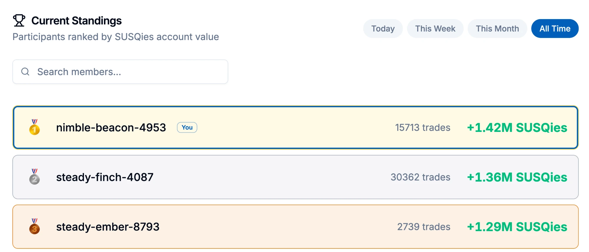
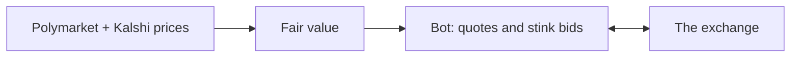
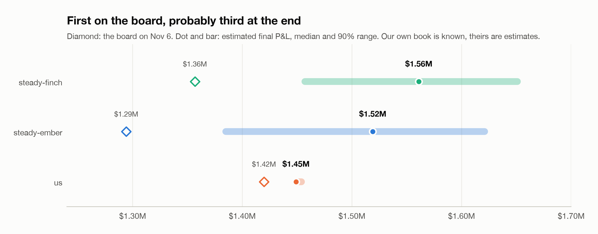

# Market making the 2026 midterms on SIG's prediction market

<table><tr><td align="center">
<a href="https://www.linkedin.com/in/teun-schuur-1b0b29270/"> <b>Teun Schuur</b></a>
</td></tr></table>

*The all-time leaderboard on November 6, with the last races still settling. We're nimble-beacon. Enjoy it while it lasts: [we expect to finish third](#reading-the-other-books).*

<picture>
  <source media="(prefers-color-scheme: dark)" srcset="figures/equity_curve-dark.png">
  
</picture>

From October 1 to November 4 2026, Susquehanna (SIG) ran the SIG Predictions Cup: a prediction market on the US midterms where everyone started with 100,000 play dollars and was ranked on their balance after every market settled. There were 237 contracts ("Will the Republican Party win the Maine Senate?" and so on), a 0.5c tick, an API with 30 writes and 100 reads a minute, and by the end 1,969 accounts on the leaderboard.

I entered with an automated market maker that we started building the day before the open. It finished with **$1.55M at fair value**, about 15x the starting money, from 34,555 fills in 236 markets.

A quick word on "we", because you'll see a lot of it. "I" is me, Teun. "We" is me and Claude, the AI that wrote most of the code: 134 of the project's 135 commits have its name on them. Claude doesn't sleep, had no exams and never once asked for a share of the SUSQies. When I write "we fixed a bug", I pointed at something weird and Claude went digging. When I write "we introduced a bug", there are also two suspects, and I've decided not to investigate further.

Almost nothing went the way we planned on day one. This is the story of what happened instead.

## The day before

The plan was textbook market making. Polymarket and Kalshi run deep markets on the same races, so their prices give a decent fair value. The competition's books would be thin and full of people clicking by hand. Quote both sides around that fair and collect the spread.

I wanted us to be the fastest one there, so a good part of September 30 went into finding where the API actually runs. The response headers showed that my requests from the Netherlands landed in Frankfurt and were then forwarded to San Francisco, at 270-290 ms a call. We tried a bunch of AWS servers and settled on a small one in us-west-1a, where the same request came back in 34 ms instead of 199 ms. It cost about $24 a month.

The other decision that day looked minor. Late in the afternoon we added one more thing to the engine: a 3,000-share bid at 0.5c and an ask at 99.5c in every market, in case someone fat-fingered an order. Traders call these stink bids. It was almost an afterthought. It turned out to be the most important line of config in the whole project.

## The opening hour

Trading opened on October 1 at 16:00 UTC, with everyone hitting the API at once. Batches came back with 503s and cancels took 1-2 seconds each. Our engine sent its batches back to back, got stuck waiting to reconcile the account, and for the first half hour the only orders it managed to rest were the stinks. No quotes at all.

It didn't matter. The first fill came 19 seconds after the open: someone sold us 3,000 shares of "Democrats win the House" at 0.5c while Polymarket had it at 91c. Then more, all over the board. People sold at 0.5c and bought at 99.5c into near-empty books, because they asked for a size and not a price. After 32 minutes the account was worth $190k at fair value, all of it from orders we almost didn't place.

The best fill of the day came from a bug. Because the engine was stuck, it couldn't see that its House stink had filled, so it kept placing a new one. At 16:20 someone sold 43,350 shares into it at 0.5c. That one fill is worth $43k. A minute later I placed a 200,000-share ask at 99.5c on the Senate by hand, because the bot was too busy being broken to do it.

## The cash that wasn't locked

Up to then we had sized everything assuming that a resting order locks cash, like a broker would. The engine split the balance across all its orders so that every one of them could be paid for if they all filled at once. That made every order small.

An hour in, the numbers didn't add up. The balance read 131,491 with about $57k of orders resting. The engine then cancelled $48k of those orders and the balance went to 132,057, which was exactly the fills in between. If the exchange held cash for open orders, it should have jumped by $48k. It didn't, because nothing is reserved for resting orders. The balance is only checked when an order arrives.

So a 1M-share stink at 99c costs nothing until it fills, and when it fills it costs 1c a share for something worth a dollar. That evening the stinks went from 3,000 shares to 20,000, and a new layer of "deep" orders went in that could each reach 100k. Even so, the account in first place had about four times our P&L by the evening, mostly, I think, because their stinks were bigger than ours.

The catch came four days later, and it was expensive. An order is checked against the balance minus your other orders in that same market. For the first four days, 97-99% of our placements got an "ok" back without ever resting. The dashboard showed hundreds of orders going out every minute and almost none on the book. Once the engine filtered out orders that wouldn't be admitted, the same write budget went to orders that could actually fill. It's the most expensive bug I've had in any project, and on the dashboard everything looked busy and fine.

## Where the money came from

<picture>
  <source media="(prefers-color-scheme: dark)" srcset="figures/daily-dark.png">
  
</picture>

Over half of the total came in the first three days. On a fresh exchange with thin books, people sent big market orders that went straight through every level on one side, and whoever rested deep in the book got filled at prices that made no sense. So the bot became mostly a machine for resting large orders far from fair and getting the cash back out of the positions they left behind.

Most fills sit near zero edge, and the money is in the few dots far above the line:

<picture>
  <source media="(prefers-color-scheme: dark)" srcset="figures/fill_map-dark.png">
  
</picture>

The 87 fills more than 30c through fair are worth $417k. The 3,313 fills 10-30c through fair, mostly deep orders and takes of stale quotes, are worth $1.50M. Everything within 2c of fair, which is what I set out to do, added about $80k.

I didn't give up on tight quoting easily. On October 3 the big sweeps were fading and I was ready to pivot to tight market making. We ran simulation after simulation of it. Over one 48-hour replay of the live engine, the orders resting in front of sweeps made $93k and the near-fair quotes made $200. Not $200k. Two hundred dollars.

## Running out of cash

Every fill of a deep order turns cash into a position that only pays out at settlement. On October 6 the balance was 17 dollars. I seriously considered starting over with something simpler, because there were so many layers that I couldn't tell anymore what was doing what. The numbers talked me out of it: $844k was sitting in five positions, the biggest a 500k-share short on "Republicans win the Rhode Island Senate". Selling them would have cost 12-18% of their value. The cash had turned into positions, and getting it back had a price.

Over five weeks that price came to about $1.1M of value given up to free cash. It was worth it, because that cash funded the fills above, but it was the biggest single cost and the hardest thing to tune. So we built simulators to tune it. The first one overstated how deep sweeps reach and pushed us to a return floor that was far too strict. The replacement was calibrated against real fills until it landed within 1.1-1.2x of them, and a numba rewrite made it 25x faster, so a change could be tested over many windows instead of one. A change only went live after it won in several windows, in a replay of the real code, and under a stress setting.

## Getting ready for one night

Results night was the obvious opportunity. When a race is called, its loser goes to zero on Polymarket and Kalshi within seconds, but the books here are full of orders people placed days ago and aren't watching. A scan of all 237 books on October 29 found about $40M of expected profit sitting at levels a call would pay at least 20c a share on. Nobody had the cash to take more than a sliver of it. Cash would be the limit again.

So we started hoarding, from $165k to $324k in one round. Two days before the election we built one more simulator that played out the night with every quote stale and other bots competing for the same levels. Its first result was a warning: our own 7,000 resting orders were among the biggest stale quotes around, and other bots would pick them off for about $730k. The night plan started with one global cancel-all at 21:00 UTC.

One more idea of mine: if election night brings more panicked traders, the stinks should stay, and be much bigger. At 21:22 UTC they went to 1M shares at 1c and 99c in every market.

## Election night, and my exams

<picture>
  <source media="(prefers-color-scheme: dark)" srcset="figures/night-dark.png">
  
</picture>

The biggest night of the competition fell in my exam week. Staying up all night wasn't an option, so I had to do something a little uncomfortable: go to bed in the middle of it.

The first hours I watched. Soon after the first polls closed at 23:00 UTC, the stinks started filling. At 23:53 someone bought 41k shares of FL-09 R from our 99c ask while the race was a coin flip. It went to the Democrat: +$40k. Around midnight other people caught on and started placing big orders one tick in front of our stinks, so we added 50k-share stinks in front of them. Then came the worst idea of the night. Takers were buying near-certain losers at 10c and up, so the bot started selling those longshots at 6c through fair. In ten minutes it spent about $500k of cash at a 6.9% return, which was worse than keeping that cash for later calls.

Soon after that I went to sleep and handed everything over. My last instruction was that Claude was completely in control of the system's health and the trading, and that it shouldn't ask me anything anymore. It checked the engine every ten minutes, and it deployed three fixes while I slept. Two of the best fills came during those hours:

- 02:16 UTC: 244k shares of Alaska Senate R sold into our 1c bid, fair 17c: +$55k.
- 06:09 UTC: Mississippi Senate D dumped into our 2c bid, shortly before the race moved toward the Democrats.

I woke up to a log of what it had done and why, which beats most morning-afters. The stinks were the night's best strategy by far: about +$186k on $17k of cash.

The last hour had one more gift. At 16:23 UTC, ten minutes after we'd spent our last cash, someone sold 88k shares of Rhode Island Senate D into our resting bids at 9.5-10c, with the fair at 99.8c. That's +$79k, the single best fill of the competition. Rhode Island's Senate race ended up worth $194k across its two markets, more than any other race, and it had been in the top holdings since the first week. Across 236 markets only one lost real money: MN-01 R, −$63k, where we bought 138k shares at 64.5c on election night. Remember that race.

## Reading the other books

<picture>
  <source media="(prefers-color-scheme: dark)" srcset="figures/leaderboard-dark.png">
  
</picture>

The leaderboard values open positions at about a four-hour average of traded prices, which lags reality by hours and swings with single small trades. Our board number sat $100-300k below our value at fair for most of the last day. So the board alone couldn't tell us where we really stood, and we started tracking it ourselves.

From October 24 we logged the top of the board every minute, along with the prices used to value our own positions. You can't see anyone's positions, only their P&L and trade count. But if a market's price moves 1c and nothing else moves, and an account makes $9k that same minute without trading, that account holds about 900k shares. Do this across enough quiet moments and you can read a book you were never meant to see. As a check, the same test on markets an account clearly doesn't hold comes out near zero.

It showed two very different competitors. steady-ember holds a roughly 1.3M-share bet on Democrats winning the Mississippi Senate, bought around 20c, and hasn't traded since before the election. steady-finch is long about 800k shares of Democrats winning the Senate and short about 700k of Republicans winning it. Both bets came in.

That's why I expect us to drop to third. As I write this, 187 of 237 markets have settled, and most of our money has already landed. Their big markets haven't, and they're still valued well below what they'll pay: Republicans winning the Senate still counts at 17c on a contract Kalshi has already resolved to zero. Each of them has something like $200k still to come. We have about $30k.

<picture>
  <source media="(prefers-color-scheme: dark)" srcset="figures/standings-dark.png">
  
</picture>

We put ranges on it by resampling the position estimates and simulating the open races at Kalshi's prices: about 80% third, 15% second and 4% first. The ranges are soft, especially for steady-finch. And yes, our one route to first runs through MN-01, the only race that lost us real money. If the Republican comes back there, we win about $90k and steady-finch seems to lose about $240k. Kalshi gives it about 4%.

## How Claude and I worked

This is the part that surprised me most. About 18k lines of Python, 298 tests, a dashboard, replays and three simulators, in five weeks, next to my studies. I couldn't have done that alone.

The split was simple. I decided what to build and what to trade, and Claude Code wrote the code, dug through the data and ran the experiments. A typical loop was me saying something looked off on the dashboard, Claude pulling the fills and logs, finding the cause, writing a failing test, fixing it and deploying. The ideas that made the most money, the stinks and saving cash for election night, came from staring at order books. The speed came from not having to do everything else by hand.

A few things made it work:

- **A desk tool.** `desk.py` shows the live engine's status, positions, orders, fills and any market's book in the terminal, and a small skill told Claude how to use it. From then on it could check the real system itself and stopped guessing.
- **Memory.** Claude kept short notes between sessions, 18 by the end, on things like how settlement timing works and that it must never touch the other servers on my AWS account. New sessions started knowing what the last one had learned.
- **Hard rules.** Tests pass before a deploy, and a restart must keep every resting order. Within those rules it could commit, deploy and tune on its own.
- **Numbers first.** Claude can be confidently wrong in a very calm voice, so I kept asking for the number from the real data. I sometimes had OpenAI's Codex review the work as a second opinion, and simulators settled most arguments.

Claude also drafted this write-up from our conversations and the fills, and I edited it. The bad jokes are shared work.

## What I'd tell myself on September 30

**Place the stinks, and make them big.** The edge on a young, thin exchange is in being there when someone makes a mistake, with size, at a price far from fair.

**Find out what the exchange actually does with your orders.** Two of our biggest early mistakes came from assuming how cash works. Both would have been caught in an hour of testing against the real API.

**Think in return on cash.** When cash is limited, every strategy competes for the same dollars, and the price of freeing cash matters as much as the edge of the trade it funds.

**Emergency settings need an expiry date.** A rule we added in the October 1 panic was still quietly eating most of our rate limit four weeks later. One market showed it: 13,239 pointless takes in six hours.

The engine, the research and the trade data stay private. The figures come from [`make_figures.py`](make_figures.py).

Thanks to SIG for running the Cup. It was a lot of fun, and I'll update this with the final standings once every market has settled.
